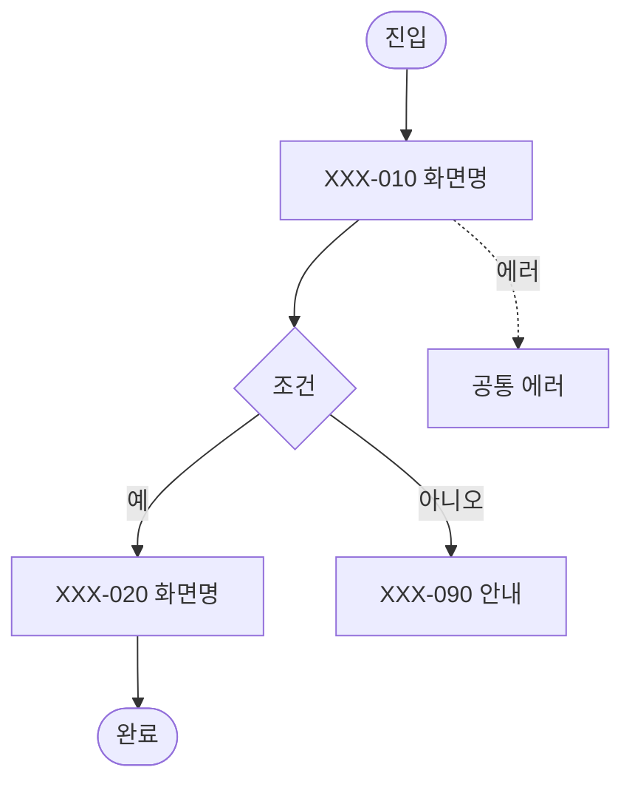

# 플로우: [도메인명]

<!--
작성 가이드
- 이 양식을 docs/ui-flow/<도메인>.md로 복사해 작성한다. 도메인 하나 = 파일 하나.
- 화면 명세의 "플로우" 칸은 이 문서의 4번 하위 섹션(#앵커)으로 연결한다.
- 화면 안의 세부 동작은 화면 명세(4번 인터랙션)에 적고, 여기에는 화면 사이의 이동만 적는다.
- 해당 없는 섹션은 "해당 없음"이라고 적는다. 이런 주석은 작성이 끝나면 지운다.
-->

| 항목 | 내용 |
|---|---|
| 도메인 | [도메인명 / 약어] |
| 상태 | 초안 / 검토 / 확정 |
| 최종 수정 | [YYYY-MM-DD] |

## 1. 개요
- 목적:
- 진입점: [어느 화면·메뉴에서 들어오는지]
- 전제 조건: [로그인, 본인인증, 보유 상품 등]

## 2. 화면 목록
| 화면 ID | 화면명 | 역할 | 명세 |
|---|---|---|---|
| | | | [링크](../screens/<화면ID>.md) |

## 3. 흐름도
<!--
표기 규칙 (Mermaid)
- 화면 노드: ID["화면ID 화면명"]
- 판단 지점: ID{"조건"}
- 정상 이동: 실선 화살표   /   예외·에러 이동: 점선 화살표 (아래 예시 참고)
- 시작·종료: ID(["시작"]) / ID(["완료"])
- 한 도표에 화면이 15개를 넘으면 4번 하위 흐름별로 나눠 그린다.
-->

## 4. 하위 흐름
<!-- 하위 흐름마다 ### 제목을 단다. 화면 명세는 이 제목으로 연결한다. -->
### 4.1 [하위 흐름명]
1. [화면ID]에서 [동작] → [화면ID]
2.

## 5. 분기 조건
| 분기 지점 (화면ID) | 조건 | 이동 화면 | 비고 |
|---|---|---|---|
| | | | |

## 6. 예외·에러 흐름
<!-- 공통 예외(세션 만료·점검·네트워크 오류·인증 실패)와 이 도메인만의 예외를 함께 적는다. -->
| 상황 | 발생 화면 | 처리 | 복귀 지점 |
|---|---|---|---|
| 세션 만료 | 전체 | | |
| 서비스 점검 | 전체 | | |
| 네트워크 오류 | | | |
| 인증 실패 | | | |

## 7. 뒤로 가기·이탈
- 뒤로 가기 동작: [이전 화면 / 플로우 처음 / 확인 후 이탈]
- 입력 중 이탈 시 확인 여부:
- 완료 화면 이후 뒤로 가기: [막음 / 홈으로] — 중복 실행 방지
- 중간 저장(이어하기) 여부:

## 8. 완료 / 이탈 지점
| 지점 | 결과 | 다음 이동 |
|---|---|---|
| | | |

## 9. 미결 사항
| 질문 | 확인 대상 (기획/디자인/개발) | 상태 |
|---|---|---|
| | | 열림 |
